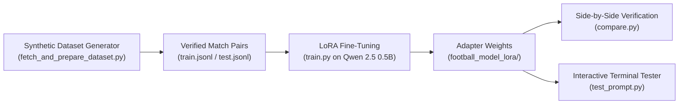

# Premier League Match Report Generator
**Enoch Obikoya**

Turns raw Premier League match scores and goal lists into clean, accurate, one-sentence match summaries. Fine-tuned on **Qwen 2.5 (500M)** using **LoRA** to eliminate hallucinations such as inventing scorers, fabricating competitions, or misidentifying winners.

---

## System Architecture



- **Data Generator (`fetch_and_prepare_dataset.py`)**: Generates 250 realistic synthetic Premier League match results with verified ground-truth summaries (clean sheets, close wins, draws).
- **LoRA Training (`train.py`)**: Adapts attention projection layers (`q_proj`, `k_proj`, `v_proj`, `o_proj`, `r=16`) while keeping the 500M backbone frozen.
- **Evaluation (`compare.py` & `test_prompt.py`)**: Demonstrates side-by-side elimination of hallucinations and provides an interactive testing console.

---

## Setup & Running in Spyder / Terminal

### 1. Install Dependencies
```bash
pip install -r requirements.txt
```

### 2. Project Execution

Run the scripts in order in your terminal or by pressing **F5** in Spyder:

1. **`fetch_and_prepare_dataset.py`** &rarr; Generates `train.jsonl` (212 samples) and `test.jsonl` (38 samples).
2. **`train.py`** &rarr; Trains the LoRA adapter and saves weights to `football_model_lora/`.
3. **`compare.py`** &rarr; Runs side-by-side evaluation (Untrained Base Model vs. Fine-Tuned Model).
4. **`test_prompt.py`** &rarr; Interactive tester where you can type any match result to get an immediate summary.
5. **`pipeline_interactive.py`** &rarr; Runs steps 1, 2, and 3 in one single execution.
