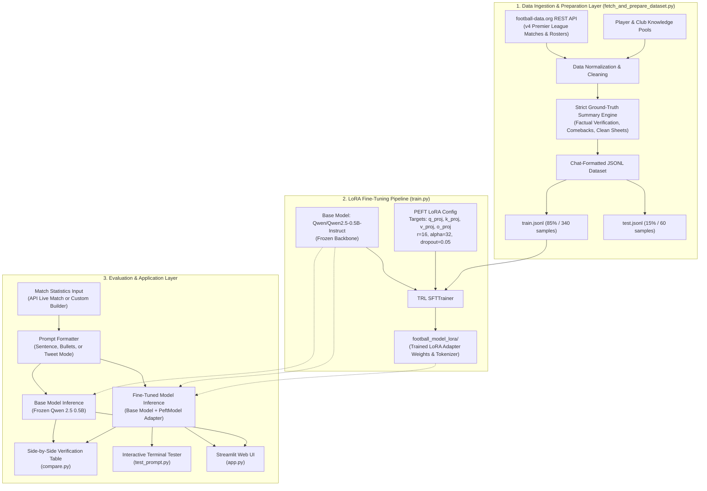

# Premier League Match Report Generator
Enoch Obikoya

I put this project together to turn raw Premier League match scores and goal lists into clean, one-sentence match summaries. A big reason I built this was because I wanted to use LoRA and learn how it works hands-on for adapting language models to a specific task.

Smaller open-source models often hallucinate when you hand them match stats. When tested on simple scores, the base model would frequently mix up winners, hallucinate competitions that never happened, or invent scorers. To resolve this, I fine-tuned a 500M parameter model (**Qwen 2.5**) using LoRA so that it strictly adheres to the provided scoreline and teams.

## How It Works

The workflow is broken down into a few practical steps:

1. **Data preparation**: A script connects to the **football-data.org API** to fetch authentic Premier League match results across seasons, supplementing them with verified non-hallucinatory synthetic fixture generation for comprehensive coverage.
2. **Fine-tuning**: LoRA trains low-rank adapter weights on multi-head attention projection layers (`q_proj`, `k_proj`, `v_proj`, `o_proj`) while keeping the backbone frozen, enabling efficient training on CPU or GPU.
3. **Verification**: A comparison script runs unseen fixtures through both the base model and the fine-tuned adapter side by side to verify zero hallucination.
4. **Interactive Apps**: An interactive terminal tester and a **Streamlit Web UI** supporting real-time API match loading, custom scoreline construction, and multiple output styles (recap sentences, tactical bullets, and social media tweets).

## System Architecture

The following diagram illustrates the complete end-to-end architecture, from live football-data.org API ingestion and LoRA parameter-efficient fine-tuning to side-by-side verification and web UI inference:



### Architectural Breakdown

1. **Data Ingestion Layer (`fetch_and_prepare_dataset.py`)**
   - **REST API Integration**: Queries `football-data.org` for real Premier League matchdays, official scorelines, and half-time splits.
   - **Ground-Truth Logic**: Generates clean, deterministic summaries distinguishing clean sheets, close wins, dominant margins, and second-half comebacks.
   - **Dataset Splitting**: Formats entries into OpenAI/Qwen chat schemas (`system`, `user`, and `assistant`) with an 85/15 train-test split.

2. **PEFT / LoRA Training Layer (`train.py`)**
   - **Base Model**: Uses `Qwen/Qwen2.5-0.5B-Instruct` as a lightweight causal language model backbone.
   - **Low-Rank Adaptation (LoRA)**: Freezes the base model and adapts multi-head attention projection layers (`q_proj`, `k_proj`, `v_proj`, `o_proj`) with `r=16`, `lora_alpha=32`, and `lora_dropout=0.05`.
   - **Supervised Fine-Tuning**: Employs Hugging Face TRL `SFTTrainer` with a cosine learning rate scheduler across 5 epochs.
   - **Artifact Persistence**: Saves adapter weights and tokenizer configuration into `football_model_lora/`.

3. **Inference & Application Layer (`app.py`, `compare.py`, `test_prompt.py`)**
   - **Streamlit Web Application (`app.py`)**: Web dashboard offering live fixture selection via the football-data.org API, a custom fixture builder, side-by-side model comparison, and multiple journalism output formats (One-Sentence Recap, Tactical Bullets, Social Media / Tweet).
   - **Side-by-Side Evaluation (`compare.py`)**: Concurrently compares baseline output with the fine-tuned adapter on unseen fixtures to verify hallucination elimination.
   - **Interactive Terminal Loop (`test_prompt.py`)**: Terminal tool supporting custom inputs and live fixture retrieval with format switching.

## Project Files

- `app.py`: Streamlit web dashboard with live API fixture selector, custom match builder, and side-by-side model comparison.
- `fetch_and_prepare_dataset.py`: Fetches real fixtures from football-data.org and builds `train.jsonl` and `test.jsonl`.
- `train.py`: Trains LoRA adapter weights on Qwen 2.5 and outputs to `football_model_lora/`.
- `compare.py`: Compares baseline model outputs against the fine-tuned LoRA model on unseen matches.
- `test_prompt.py`: Terminal CLI for testing custom match inputs or live fixtures with multiple format modes.
- `pipeline_interactive.py`: Runs dataset generation, training, and comparison in a single automated sequence.
- `train.jsonl` / `test.jsonl`: Formatted match pairs used for fine-tuning and evaluation.
- `requirements.txt`: Package dependencies including PyTorch, Transformers, PEFT, TRL, and Streamlit.

## Setup

Install the required packages:

```bash
pip install -r requirements.txt
```

*(Optional)* Set your API token as an environment variable (or let the app use the built-in token):

```bash
export FOOTBALL_DATA_API_KEY="8cb8eb39b3914b2fbd3f515f8c62f36e"
```

## Running the Project

### 1. Launch the Streamlit Web UI

```bash
streamlit run app.py
```

### 2. Run the Command-Line Pipeline

**Step 1: Create or Refresh the Dataset**
```bash
python fetch_and_prepare_dataset.py
```

**Step 2: Train the LoRA Model**
```bash
python train.py
```

**Step 3: Run Baseline vs LoRA Comparison**
```bash
python compare.py
```

**Step 4: Interactive Terminal Testing**
```bash
python test_prompt.py
```

## Results

The difference between the base model and the fine-tuned version is immediately noticeable. On a 2-2 draw between West Ham and Manchester City, the base model claimed Manchester City won and that Paqueta scored twice for them. After training, the model correctly summarized that the teams shared the points in an entertaining 2-2 draw. It reliably picks up on clean sheets, draws, second-half comebacks, and close wins without fabricating match details.
