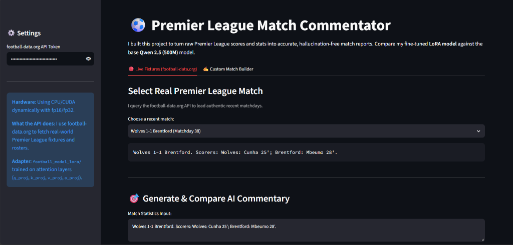
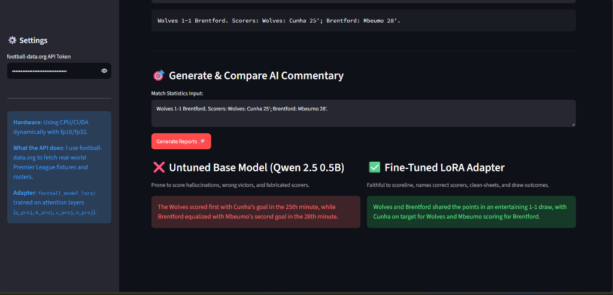
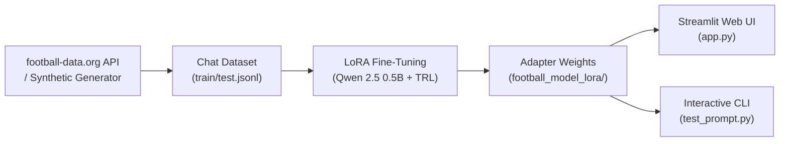

# Premier League Match Report Generator
Enoch Obikoya

I put this project together to turn raw Premier League match scores and goal lists into clean, one-sentence match summaries. A big reason I built this was because I wanted to use LoRA and learn how it works hands-on for adapting language models to a specific task.

Smaller open-source models often hallucinate when given match stats. When tested on simple scores, the base model would frequently mix up winners, hallucinate competitions that never happened, or invent scorers. To resolve this, I fine-tuned a 500M parameter model (**Qwen 2.5**) using **LoRA** so that it strictly adheres to the provided scoreline, teams, and goalscorers.

---

## Application Demo

### Live Fixtures & Match Selector


### Side-by-Side Model Comparison


---

## System Architecture



- **Data Ingestion (`fetch_and_prepare_dataset.py`)**: Pulls real Premier League fixtures from football-data.org, applies factual summary logic (exact scorelines, winners, clean sheets, comebacks, and goalscorers), and splits them into `train.jsonl` and `test.jsonl`.
- **LoRA Training (`train.py`)**: Fine-tunes attention projection matrices (`q_proj`, `k_proj`, `v_proj`, `o_proj`, `r=16`) on frozen Qwen 2.5 0.5B weights using Hugging Face TRL.
- **Inference & UI (`app.py` & `test_prompt.py`)**: Streamlit web dashboard and terminal tester for live fixtures, custom scorelines, and side-by-side comparison against the base model.

---

## Setup & API Key

1. **Install dependencies**:
   ```bash
   pip install -r requirements.txt
   ```

2. **API Configuration**:
   The project connects to the **[football-data.org](https://www.football-data.org/)** REST API to fetch live Premier League fixtures, matchday results, official scores, and current squad rosters.
   You can register for a free API token at [football-data.org](https://www.football-data.org/).

   Set your token in your terminal or enter it in the Streamlit app sidebar:
   ```bash
   # Linux / macOS
   export FOOTBALL_DATA_API_KEY="your_api_key_here"

   # Windows (PowerShell)
   $env:FOOTBALL_DATA_API_KEY="your_api_key_here"
   ```
   *(Note: If no API key is set, the data generator automatically falls back to verified synthetic Premier League fixtures.)*

---

## Running the Project

### Launch the Streamlit Web UI
```bash
python run_gui.py
```
*(Or in Spyder: open `run_gui.py` and press **F5**)*

### Or Run via Terminal Pipeline
```bash
# 1. Fetch real / synthetic dataset
python fetch_and_prepare_dataset.py

# 2. Train the LoRA adapter
python train.py

# 3. Compare baseline vs fine-tuned model
python compare.py

# 4. Interactive match tester
python test_prompt.py
```

---

## Results

The difference between the base model and the fine-tuned version is immediately noticeable. On a 1-1 draw between Wolves and Brentford:
- **Untuned Base Model**: Claimed that *"The Wolves scored first with Cunha's goal in the 25th minute, while Brentford equalized with Mbeumo's second goal in the 28th minute"* (hallucinating that Mbeumo scored a second goal).
- **Fine-Tuned LoRA Adapter**: Accurately reported that *"Wolves and Brentford shared the points in an entertaining 1-1 draw, with Cunha on target for Wolves and Mbeumo scoring for Brentford."*
