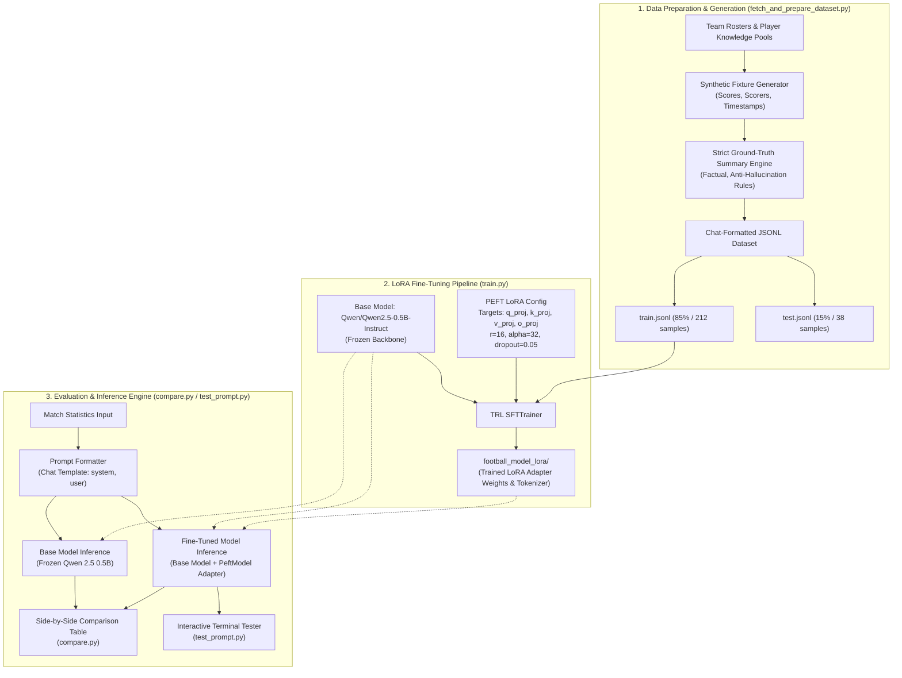

# Premier League Match Report Generator
Enoch Obikoya

I put this project together to turn raw Premier League match scores and goal lists into clean, one sentence match summaries. A big reason I built this was because I wanted to use LoRA and learn how it works hands-on for adapting language models to a specific task.

Smaller open source models often mess up when you hand them match stats. When I tested the base model on simple scores, it would constantly hallucinate details, mix up which team actually won, or make up competitions that never happened. To fix this, I fine tuned a small 500M parameter model (Qwen 2.5) using LoRA so that it sticks strictly to the actual scoreline and teams provided.

## How It Works

The workflow is broken down into a few practical steps:

1. Data preparation: A script generates synthetic fixtures with realistic scores, goalscorers, and minute marks, paired with verified match summaries.
2. Fine tuning: I used LoRA to train adapter weights on the attention layers while keeping the rest of the base model frozen. This keeps memory usage low enough to train directly on a standard CPU.
3. Verification: A comparison script runs unseen fixtures through both the base model and my fine tuned adapter side by side so you can clearly see the improvement.
4. Testing: An interactive script where you can type or paste any match result and test the model immediately.

## System Architecture

The following diagram illustrates the complete end-to-end architecture, from synthetic fixture generation and LoRA parameter-efficient fine-tuning to side-by-side verification and interactive inference:



### Architectural Breakdown

1. **Synthetic Data Generation Layer (`fetch_and_prepare_dataset.py`)**
   - **Knowledge Pools**: Contains rosters of Premier League clubs and key goalscorers.
   - **Ground-Truth Logic**: Generates realistic scorelines and timestamps, pairing each fixture with a strictly deterministic, non-hallucinated summary based on the exact outcome (clean sheets, close wins, high-margin victories, draws).
   - **Schema Formatting**: Encodes samples into chat message structures (`system`, `user`, and `assistant`) and outputs split files (`train.jsonl` and `test.jsonl`).

2. **PEFT / LoRA Training Layer (`train.py`)**
   - **Base Model**: Uses `Qwen/Qwen2.5-0.5B-Instruct` as a compact causal language model (~500M parameters) capable of running and training efficiently on CPU or GPU.
   - **Low-Rank Adaptation (LoRA)**: Injects trainable rank decomposition matrices into the multi-head attention projection layers (`q_proj`, `k_proj`, `v_proj`, `o_proj`) with `r=16`, `lora_alpha=32`, and `lora_dropout=0.05`, keeping all base model parameters frozen.
   - **Supervised Fine-Tuning**: Trains via Hugging Face TRL `SFTTrainer` with a cosine learning rate scheduler for 5 epochs.
   - **Artifact Persistence**: Serializes adapter weights and tokenizer configuration to `football_model_lora/`.

3. **Inference & Comparison Layer (`compare.py` & `test_prompt.py`)**
   - **Dual Evaluation**: Loads the untuned base model and the LoRA-adapted model (`PeftModel`) concurrently to verify the suppression of hallucinations.
   - **Greedy Generation**: Uses deterministic greedy decoding (`do_sample=False`, `max_new_tokens=40`) to generate concise, factual single-sentence match reports.
   - **Interactive Interface**: Provides an interactive terminal loop for real-time testing on arbitrary match inputs.

## Project Files

fetch_and_prepare_dataset.py generates the training and test files.

train.py runs the LoRA training and saves the adapter weights into the football_model_lora folder.

compare.py compares outputs from the baseline model against the fine tuned model on test matches.

test_prompt.py lets you test custom match inputs directly in your terminal or Spyder console.

pipeline_interactive.py runs all three main steps in order if you want to execute everything in one go.

train.jsonl contains the match pairs used for training.

test.jsonl contains the unseen matches used for testing.

requirements.txt lists the Python packages needed.

## Setup

Install the required libraries with pip:

```bash
pip install -r requirements.txt
```

## Running the Project

Run each step in order from your terminal or IDE:

Step 1: Create the dataset
```bash
python fetch_and_prepare_dataset.py
```

Step 2: Train the model
```bash
python train.py
```

Step 3: Run the comparison
```bash
python compare.py
```

Step 4: Test prompts
```bash
python test_prompt.py
```

## Results

The difference between the base model and the fine tuned version is noticeable right away. For example, on a 2-2 draw between West Ham and Manchester City, the base model claimed Manchester City won and that Paqueta scored twice for them. After training, the model correctly summarized that the teams shared the points in an entertaining 2-2 draw. It reliably picks up on clean sheets, draws, and close wins without making up false events.

