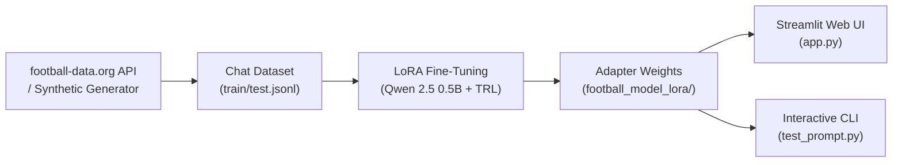

# Premier League Match Report Generator
**Enoch Obikoya**

Turns raw Premier League scores and match statistics into accurate, hallucination-free match summaries. Fine-tuned on **Qwen 2.5 (500M)** using **LoRA** to eliminate common model errors like fabricating scorers, misidentifying winners, or mixing up scorelines.

---

## Architecture Overview



- **Data Ingestion (`fetch_and_prepare_dataset.py`)**: Pulls real Premier League results from the football-data.org API, applies factual summary rules (margins, clean sheets, comebacks), and splits into `train.jsonl` / `test.jsonl`.
- **LoRA Training (`train.py`)**: Fine-tunes attention projection matrices (`q_proj`, `k_proj`, `v_proj`, `o_proj`, `r=16`) on frozen Qwen 2.5 0.5B weights.
- **Inference & UI (`app.py` & `test_prompt.py`)**: Provides a Streamlit dashboard and terminal tester for live fixtures, custom scorelines, and multiple summary styles (recap sentences, tactical bullets, social media tweets).

---

## Setup & API Key

1. **Install dependencies**:
   ```bash
   pip install -r requirements.txt
   ```

2. **Get a Free API Key**:
   To fetch live and historical Premier League fixtures, register for a **free** account at [football-data.org](https://www.football-data.org/) to obtain your API token.

   Set it in your terminal or paste it directly in the Streamlit app sidebar:
   ```bash
   # Linux / macOS
   export FOOTBALL_DATA_API_KEY="your_api_key_here"

   # Windows (PowerShell)
   $env:FOOTBALL_DATA_API_KEY="your_api_key_here"
   ```
   *(Note: If no API key is provided, the data generator automatically falls back to verified synthetic Premier League fixtures.)*

---

## Quickstart

### Run the Web Dashboard
```bash
streamlit run app.py
```

### Or Run via Terminal
```bash
# 1. Fetch real / synthetic dataset
python fetch_and_prepare_dataset.py

# 2. Train the LoRA adapter
python train.py

# 3. Compare baseline vs fine-tuned model
python compare.py

# 4. Interactive match tester
python test_prompt.py
```
